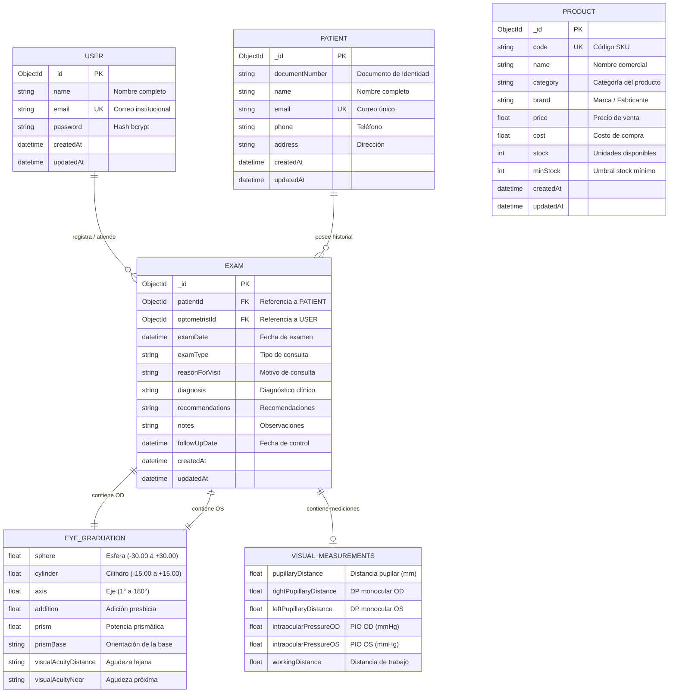

# Sprint Review Corte II – Mobile Cloud Computing IS0276 – OptiCloud

## 1. Resumen General del Sprint

Durante el **Corte II**, el equipo **TelecomPlus** ha avanzado en la evolución de **OptiCloud**, una solución móvil Android conectada a una arquitectura de servicios en la nube (Node.js/Express + MongoDB Atlas) orientada a la gestión de pacientes, exámenes optométricos y catálogo de productos de una óptica.

El seguimiento y trazabilidad del trabajo se realiza mediante **GitHub Projects**, estructurando el flujo en Historias de Usuario (HU), Bugs técnicos/seguridad, Code Smells y Acciones de Mejora derivadas de las retrospectivas.

En el tablero se observa la siguiente distribución operativa:
- **Autenticación y Seguridad:** Inicio de sesión, cierre de sesión y refactorización de seguridad en backend/frontend.
- **Gestión de Pacientes:** Creación, edición, consulta de historial y eliminación en cascada.
- **Exámenes Optométricos:** Registro de fórmulas refractivas (OD/OS) y mediciones clínicas adicionales.
- **Gestión de Inventario y Productos:** Mantenimiento del catálogo de productos y control de stock.
- **Acciones de Mejora (Retro):** Normalización de criterios de aceptación, sincronización del equipo y estándares de commits.

El propósito de esta revisión es presentar el incremento entregado, verificar el cumplimiento de la **Definition of Done (DoD)**, la integración con la base de datos en la nube y la trazabilidad del código mediante Issues, ramas y Pull Requests.

---

## 2. Estado del Tablero de Trabajo (GitHub Projects)

Con base en el estado visible del tablero oficial de **GitHub Projects**, la distribución exacta de ítems por columna es la siguiente:

| Columna | Cantidad | Descripción |
| :--- | :---: | :--- |
| **Backlog** | **8** | Historias de usuario y tareas priorizadas para próximos incrementos. |
| **To Do** | **8** | Tareas asignadas y pendientes de inicio en el ciclo actual. |
| **In Progress** | **0** | Sin tareas en ejecución al momento del corte. |
| **QA / Review** | **0** | Sin ítems pendientes de validación o revisión de código. |
| **Done** | **5** | Historias de usuario completadas que cumplen criterios de aceptación. |
| **Closed** | **10** | Bugs, refactorizaciones y correcciones cerradas y verificadas. |
| **Acciones de Mejora** | **3** | Tareas de retrospectiva y mejora del flujo de trabajo. |

---

## 3. Historias de Usuario, Bugs y Tareas Técnicas

### 3.1 Historias de Usuario (Estado en Tablero)

| Issue | Historia de Usuario | Estado |
| :---: | :--- | :---: |
| **#23** | **HU-01 – Inicio de Sesión de Usuario** | `Done` |
| **#3** | **HU-02 – Registrar Examen Optométrico** | `Done` |
| **#4** | **HU-03 – Consultar Historial de Paciente** | `Done` |
| **#7** | **HU-07 – Crear y Actualizar Datos de Paciente** | `Done` |
| **#29** | **HU-13 – Cerrar Sesión de Usuario** | `Done` |
| **#12** | HU-00 – Actualizar Stock de Producto | `Backlog` |
| **#10** | HU-08 – Editar Prescripción Existente | `Backlog` |
| **#11** | HU-04 – Buscar Productos en Catálogo | `Backlog` |
| **#5** | HU-05 – Agregar Producto al Inventario | `Backlog` |
| **#17** | HU-09 – Ver Detalles de Producto | `Backlog` |
| **#18** | HU-10 – Consultar Productos con Stock Bajo | `Backlog` |
| **#24** | HU-12 – Eliminar Producto del Catálogo | `Backlog` |
| **#25** | HU-11 – Eliminar Registro de Paciente | `Backlog` |

---

### 3.2 Bugs y Tareas Técnicas por Capa

#### Capa Backend (`Opticloud-back`)

- **`Closed` `#8`** – `[BUG Funcional]` Ausencia de eliminación en cascada de exámenes *(Juan Andrés Gómez)*.
- **`Closed` `#11`** – `[Code Smell]` Controladores monolíticos (Fat Controllers) *(Juan Andrés Gómez)*.
- **`Closed` `#9`** – `[BUG Implementación]` Middleware de validación anulado.
- **`Closed` `#13`** – `[BUG Seguridad]` Ausencia total de autenticación y autorización *(Juan Andrés Gómez)*.
- **`Closed` `#7`** – `[BUG Funcional]` Pérdida silenciosa de datos (`documentNumber`) al crear pacientes.
- **`Closed` `#12`** – `[Code Smell]` Configuración inconsistente de Timestamps en Mongoose *(Juan Andrés Gómez)*.
- **`Closed` `#10`** – `[BUG Implementación]` Respuesta JSON truncada en `getPatientById` *(Juan Andrés Gómez)*.
- **`To Do` `#14`** – `[BUG Seguridad]` API expuesta a abusos sin Helmet o Rate Limit.

#### Capa Frontend (`Opticloud-frontend`)

- **`Closed` `#3`** – `[BUG Implementación]` IP base hardcodeada (`Base URL` local) *(Adrián Leonardo Murcia)*.
- **`Closed` `#1`** – `[BUG Funcional]` Fallo silencioso en validación de `NewPatientScreen` *(Adrián Leonardo Murcia)*.
- **`Closed` `#8`** – `[BUG Seguridad]` Acciones destructivas/irreversibles sin confirmación *(Adrián Leonardo Murcia)*.
- **`To Do` `#2`** – `[BUG Seguridad]` Tráfico en texto plano habilitado (Riesgo MITM) *(Adrián Leonardo Murcia)*.
- **`To Do` `#2`** – `[BUG Funcional]` Imposibilidad de actualizar el correo electrónico *(Adrián Leonardo Murcia)*.
- **`To Do` `#4`** – `[BUG Implementación]` Uso de `collectAsState` provocando memory leaks *(Adrián Leonardo Murcia)*.
- **`To Do` `#5`** – `[Code Smell]` Acoplamiento fuerte en la inyección de Retrofit *(Adrián Leonardo Murcia)*.
- **`To Do` `#6`** – `[Code Smell]` Confusión semántica del dominio `Address`/`Documento` *(Adrián Leonardo Murcia)*.

---

## 4. Modelado e Implementación de la Base de Datos en la Nube

Para garantizar el soporte del almacenamiento persistente del incremento del Corte II, se desplegó una arquitectura NoSQL con **MongoDB Atlas**.

### 4.1 Justificación Arquitectónica
1. **Esquema Flexible:** Permite gestionar estructuras clínicas variables en exámenes optométricos (esferas, cilindros, ejes condicionales, adiciones y mediciones prismáticas opcionales).
2. **Baja Latencia en Móvil:** Subdocumentos embebidos (`OD` y `OS`) dentro del documento `Exam` evitan operaciones complejas de JOIN.
3. **Alta Disponibilidad y Seguridad:** Replica Sets de 3 nodos en MongoDB Atlas, cifrado TLS 1.3 en tránsito y AES-256 en reposo.

### 4.2 Diagrama Entidad-Relación (ERD)

### 4.3 Trazabilidad Código-Modelo
- **Colección `users`:** Definida en `src/models/user.js`. Implementa hash bcrypt de contraseñas e integración con autenticación JWT.
- **Colección `patients`:** Definida en `src/models/patient.js`. Vinculada a eliminación en cascada en `patientService.js`.
- **Colección `exams`:** Definida en `src/models/exam.js`. Incluye ordenamiento cronológico descendente (`sort({ examDate: -1 })`) e índice en `patientId`.
- **Colección `products`:** Definida en `src/models/product.js`. Controla stock e inventario crítico.

### 4.4 Acceso de Evaluación para el Docente
- **Host / Cluster:** `opticloud.y49novq.mongodb.net`
- **Base de Datos:** `opticloud`
- **Acceso Directo Atlas:** Invitación enviada al correo `endiromero@gmail.com` con el rol **Project Data Access Read Only**.

---

## 5. Flujo de GitHub y Revisión de Código

Para garantizar la calidad de software y trazabilidad del trabajo, se exigió el cumplimiento del flujo de trabajo colaborativo:
1. **Vinculación de Issues:** Cada rama y Pull Request hace referencia explícita al número de Issue correspondiente.
2. **Peer Review Obligatorio:** Ningún PR es integrado a la rama principal sin la revisión aprobada de al menos un compañero de equipo.

**Repositorios Oficiales:**
- **Frontend:** [https://github.com/telecomPlus/Opticloud-frontend](https://github.com/telecomPlus/Opticloud-frontend)
- **Backend:** [https://github.com/telecomPlus/Opticloud-back](https://github.com/telecomPlus/Opticloud-back)

---

## 6. Definición de Terminado (Definition of Done - DoD)

Cada ítem marcado en la columna `Done` o `Closed` ha verificado el cumplimiento de:
1. Criterios de aceptación plenamente satisfechos.
2. Código revisado y aprobado por otro integrante mediante Pull Request.
3. Cambios integrados exitosamente en la rama principal.
4. Pruebas de integración ejecutable sin errores regresivos.
5. Evidencias documentadas en los repositorios o en esta discusión.

Los ítems en `To Do` o `Backlog` se reagendan formalmente para ejecución en el Corte III.

---

## 7. Acciones de Mejora y Retrospectiva

En la columna **Acciones de mejora** del tablero se estructuraron los compromisos del equipo:

1. **`#26`** – `[RETRO]` Completar descripción y criterios de aceptación en Historias de Usuario (`HU-01`, `HU-08` y `HU-09`).
2. **`#27`** – `[RETRO]` Implementar reuniones breves de sincronización (`Dailies` / Sincronización semanal).
3. **`#28`** – `[RETRO]` Definir estándar de commits frecuentes y vinculación directa con tareas del Kanban.

---

## 8. Proyección para el Corte III

Para el **Corte III**, la planificación priorizará:
1. **Completar Historias de Usuario del Backlog:** Mantenimiento completo del módulo de catálogo de productos (HU-04, HU-05, HU-08, HU-09, HU-10, HU-12) y eliminación de registros de pacientes (HU-11).
2. **Atención a Deuda Técnica y Seguridad:** Implementación de Helmet/Rate Limit (`#14` backend) y solución al tráfico en texto plano / leaks de memoria (`#2`, `#4` frontend).
3. **Ajuste de Arquitectura Móvil:** Refactorización de la inyección de dependencias de Retrofit y desacoplamiento de vistas.

---

## 9. Entregables y Demostración

- **Repositorio Backend:** [https://github.com/telecomPlus/Opticloud-back](https://github.com/telecomPlus/Opticloud-back)
- **Repositorio Frontend:** [https://github.com/telecomPlus/Opticloud-frontend](https://github.com/telecomPlus/Opticloud-frontend)
- **Documento de Revisión:** `SPRINT_REVIEW_CORTE2.md`
- **Demostración en Video:** [https://teams.microsoft.com/l/meetingrecap?driveId=b%21QetbAZrGa0eBBSYzi9iKANCWmLYF2mhGqa_f4RP96C9_jjNkfRUxTZRZzrk4UxZt&driveItemId=01TZTJSXNDFKGTGTZV55DY4CFB3TA2HIZQ&sitePath=https%3A%2F%2Ffundacionlibertadores-my.sharepoint.com%2F%3Av%3A%2Fg%2Fpersonal%2Falmurcial_libertadores_edu_co%2FIQCjKo0zTzXvR44IodzBo6MwAcU7QSfgtvWgmLgpEX5asU4&fileUrl=https%3A%2F%2Ffundacionlibertadores-my.sharepoint.com%2F%3Av%3A%2Fg%2Fpersonal%2Falmurcial_libertadores_edu_co%2FIQCjKo0zTzXvR44IodzBo6MwAcU7QSfgtvWgmLgpEX5asU4&iCalUid=040000008200E00074C5B7101A82E00800000000272FC355A961DD0100000000000000001000000020652249559D7C48A88802EF06CD3C13&threadId=19%3Ameeting_NjI3MTNkNmQtMDY5NC00YjVhLThkNGEtN2IxMTMyOTAwODZm%40thread.v2&organizerId=03228300-7d1f-41a0-8707-675f33fcdcff&tenantId=98c5292c-6f85-4565-8ace-969dada78808&callId=d54a6da3-2a70-44d2-9794-c4a2ebf64874&threadType=Meeting&meetingType=Scheduled&subType=RecapSharingLink_RecapChiclet&recapType=RecordingAndTranscript](https://teams.microsoft.com/l/meetingrecap?driveId=b%21QetbAZrGa0eBBSYzi9iKANCWmLYF2mhGqa_f4RP96C9_jjNkfRUxTZRZzrk4UxZt&driveItemId=01TZTJSXNDFKGTGTZV55DY4CFB3TA2HIZQ&sitePath=https%3A%2F%2Ffundacionlibertadores-my.sharepoint.com%2F%3Av%3A%2Fg%2Fpersonal%2Falmurcial_libertadores_edu_co%2FIQCjKo0zTzXvR44IodzBo6MwAcU7QSfgtvWgmLgpEX5asU4&fileUrl=https%3A%2F%2Ffundacionlibertadores-my.sharepoint.com%2F%3Av%3A%2Fg%2Fpersonal%2Falmurcial_libertadores_edu_co%2FIQCjKo0zTzXvR44IodzBo6MwAcU7QSfgtvWgmLgpEX5asU4&iCalUid=040000008200E00074C5B7101A82E00800000000272FC355A961DD0100000000000000001000000020652249559D7C48A88802EF06CD3C13&threadId=19%3Ameeting_NjI3MTNkNmQtMDY5NC00YjVhLThkNGEtN2IxMTMyOTAwODZm%40thread.v2&organizerId=03228300-7d1f-41a0-8707-675f33fcdcff&tenantId=98c5292c-6f85-4565-8ace-969dada78808&callId=d54a6da3-2a70-44d2-9794-c4a2ebf64874&threadType=Meeting&meetingType=Scheduled&subType=RecapSharingLink_RecapChiclet&recapType=RecordingAndTranscript)
- **APK / Release:** `[Enlace a Release / APK]`
